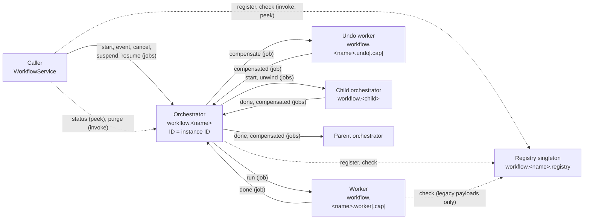
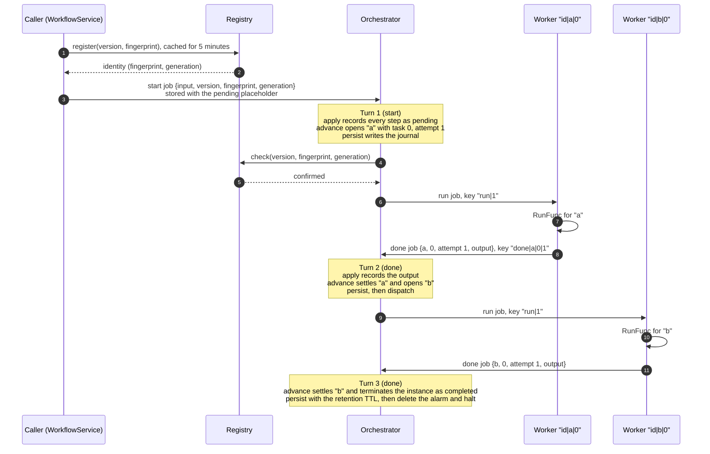

# 01. Architecture

A workflow is a built-in actor. `New` returns a `*Workflow`, and registering it with `host.RegisterBuiltInActor` registers several reserved actor types at once. This document describes those actors, how they communicate, and the life of one instance.

## The actors of one workflow

Every type below is a bare type, and the host prefixes it with `francis.builtin.` when it registers it. `<name>` is the workflow's name and `<cap>` is a capability, neither of which may contain `.` or `/`.

| Role | Bare actor type | Actor ID | How many | Registration options |
| --- | --- | --- | --- | --- |
| Orchestrator | `workflow.<name>` | The instance ID | One per instance, activated on demand | Idle timeout 5m, job `MaxAttempts` 20, retry delay 5s |
| Forward worker | `workflow.<name>.worker`, plus `workflow.<name>.worker.<cap>` per advertised capability | `<instanceID>\|<step>\|<index>` | One per task | `ConcurrencyLimit` and capacity group limit set by `WithConcurrency`, job `MaxAttempts` 5 |
| Undo worker | `workflow.<name>.undo`, plus `workflow.<name>.undo.<cap>` | `<instanceID>\|<step>\|<index>` | One per compensated task | Limits set by `WithCompensateConcurrency` |
| Definition registry | `workflow.<name>.registry` | The singleton ID | One per cluster | Idle timeout 5m |
| Auto-purge cron job | `cronjob.<name>.purge` | The singleton ID | One per cluster | Set by the cron job built-in |

A few consequences of this layout are worth spelling out:

- The orchestrator is reached at the instance ID, so the journal is simply the orchestrator's actor state, and the actor model's one-turn-at-a-time rule is what serializes everything that happens to an instance.
- A worker's actor ID is deterministic. A turn that is retried addresses the same worker actor, so the idempotency key on its job (see [05](05-dispatch-and-workers.md)) deduplicates the dispatch. The ID is readable on purpose, since it is what an operator greps for in logs and traces, which is why step names and instance IDs may not contain `|`.
- All worker queues of a workflow share one capacity group per family (`francis.builtin.workflow.<name>.worker` and `francis.builtin.workflow.<name>.undo`), so `WithConcurrency` is a strict per-host budget across the base queue and every capability queue. Compensations have their own group, so a slow unwind cannot starve forward work, and the other way around.
- A host that advertises no capability still registers the base queues, so it can run every step that requires none. A step that requires a capability is dispatched to `workflow.<name>.worker.<cap>`, which only hosts advertising `<cap>` serve, and its compensation goes to the undo queue of the same capability.
- Retention of the engine's own jobs (`CompletedJobRetention` and `DeadLetteredJobRetention`) is twice the longest journal retention, so a task's job record and the journal entry that accounts for it disappear together.

## The orchestration boundary

The orchestrator orchestrates and performs nothing. In a turn it does exactly these things:

- Reads and writes its own state (the journal), together with its listing labels and its history events
- Arms, replaces, or deletes its single `deadline` alarm
- Dispatches durable jobs to workers, to child orchestrators, and to its parent
- Cancels jobs that should no longer run
- Consults the registry singleton about the definition's identity

It never calls a `RunFunc` or a `CompensateFunc`, and the definition exposes no hook that could run on the orchestrator. Even the decisions that look like they need user code are outputs of steps: a fan-out's size is the length of an upstream step's output, and a `WithSkipIf` or `WithUntil` condition is a boolean an upstream step returned. This is enforced by the code rather than by convention, because `apply` and `advance` are pure functions of the journal and the definition and have no way to call anything.

Keeping user code off the orchestrator buys three things. The orchestrator stays free to accept the next report, a cancel, or its own deadline while a handler runs for an hour. There is no replay, so handlers have no determinism constraints. And a slow or misbehaving handler holds a worker slot, which is bounded per host, rather than an instance's only write path.

## How the actors talk

Everything that changes an instance travels as a durable job, never as a synchronous call. That makes every message survive a crash of either side, and it makes every message subject to the same at-least-once delivery, which the engine absorbs with idempotency keys and journal-based deduplication.

Solid edges are durable jobs, and dotted edges are synchronous calls. The synchronous calls are the ones whose answer the caller needs right away:

| Call | Target | Lock | Why it is synchronous |
| --- | --- | --- | --- |
| `GetStatus` | Orchestrator `Peek(status)` | Shared, so status reads never queue behind each other, only behind a write turn | The caller wants the answer |
| `Purge` | Orchestrator `Invoke(purge)` | Exclusive, so removal is serialized with the instance's own turns | The caller needs to know whether the instance was active |
| Registry `check` | Registry `Peek(check)` | Shared | Confirming a known identity must not serialize every start |
| Registry `register`, `definitions`, `forget` | Registry `Invoke` | Exclusive | Creating or removing an identity must be ordered with confirmations |

`RaiseEvent` and `Start` with a caller-chosen ID also read the journal directly through the state client before dispatching, which is a read of stored state rather than a call into the actor.

Calls that reach an actor while its placement is moving (`ErrActorHalted`, `ErrActorNotHosted`, `ErrActorNotActive`) are retried every 50ms up to 20 times by `retryWhilePlacementMoves`, because orchestrators halt when they terminate and singletons move when hosts join or leave.

## Life of an instance

This is the happy path of a two-step workflow, with the turns marked. Each turn on the orchestrator is the same pipeline, described in [04](04-turns.md).

Things to notice:

- `Start` returns as soon as the start job and its placeholder are durable, before the journal exists. The placeholder is what lets `List` and `GetStatus` show the instance as pending (see [03](03-journal.md)).
- The first journal write happens before the registry confirms the start, and no work is dispatched until it does. That ordering is what closes the race with an operator resetting the version, as [08](08-versions-and-registry.md) explains.
- Every turn arms the deadline alarm when the deadline it computes differs from the one this activation armed last, which is omitted from the diagram (see [09](09-time-and-suspension.md)).
- Workers halt themselves after reporting, so the host slot frees immediately, and the orchestrator halts once the instance terminates, so a wide fan-out does not keep one activation per finished instance.
