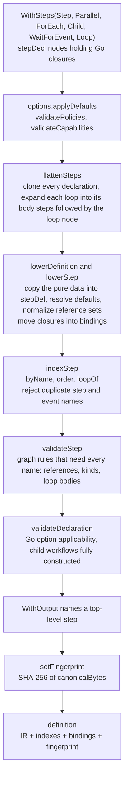
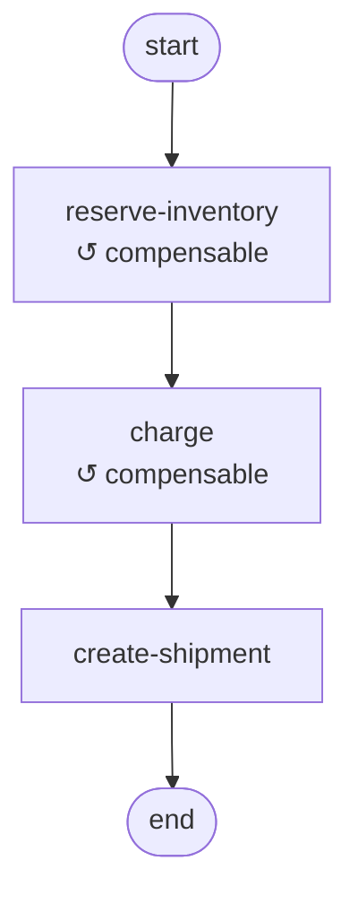
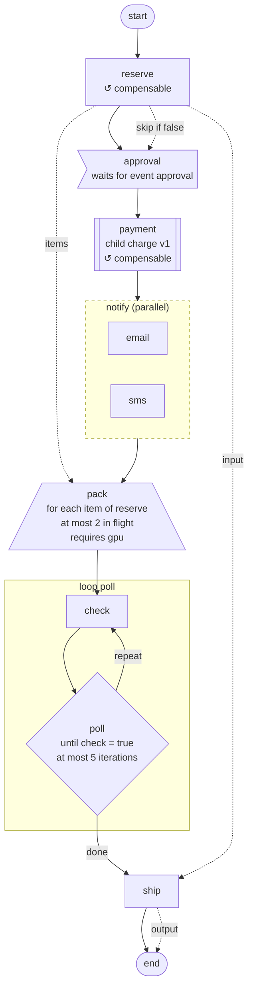

# 02. Definitions and the IR

`New` turns a list of Go declarations into a `definition`: a validated, language-neutral IR, the indexes the engine needs to walk it, the Go handlers bound to it on this host, and the fingerprint that identifies it. This document follows that pipeline, describes the IR and its canonical encoding, and ends with the tools that print an IR for a person to read.

## Why there is an IR

The engine needs two different things from a definition, and the IR is what keeps them apart.

- **What the graph is.** The steps, their order, their kinds, and every policy that governs how an instance runs. This has to be identical on every host that drives an instance, has to be comparable across hosts, and has to be hashable into a stable identity.
- **What code runs for each step on this host.** The `RunFunc` and `CompensateFunc` closures, and the `*Workflow` a child step starts. These are Go values that cannot be compared or hashed, and that may legitimately differ between hosts, for example when a bug in a handler body is fixed in a rolling deployment.

The IR (`definitionIR` and `stepDef` in `ir.go`) holds only the first kind of thing, as plain data. The second kind is kept in `definition.bindings`, keyed by step name. Because handlers are not in the IR, changing a handler's body does not change the fingerprint and needs no version bump, while adding or removing a handler does, since `hasRun` and `hasCompensate` are in the IR.

The IR is also the seam for frontends other than the Go DSL: a frontend in another language that produced the same IR would produce the same fingerprint, so its hosts could serve the same version as Go hosts, provided they bind handlers for the same step names.

## From declarations to a definition



The three layers of types:

| Type | File | Holds | Lifetime |
| --- | --- | --- | --- |
| `stepDecl` | `step.go` | `stepData` plus the closures, members, and child `*Workflow` | Built by the DSL constructors and options, cloned by `flattenSteps`, discarded after lowering |
| `stepDef`, `definitionIR` | `ir.go` | `stepData` and `definitionData` only, plus members and the child's `(name, version)` | Immutable for the life of the `Workflow` |
| `definition` | `ir.go` | The IR plus `fingerprint`, `byName`, `order`, `loopOf`, and `bindings` | Shared by every actor the workflow registers on this host |

`stepData` and `definitionData` are shared by the DSL and the IR on purpose: the options write straight into the same struct the IR is made of, so there is no mapping between them to keep in sync.

### Flattening loops

A loop declares its body inline, but the engine walks a flat list. `flattenSteps` replaces each `Loop` with its body steps followed by the loop node itself, records the body as names in `stepData.body`, and clears the loop's members. So this declaration:

```go
Loop("poll",
	Step("check", WithRun(checkReady)),
	Step("pause", WithRun(pause)),
).With(WithUntil("check", true), WithMaxIterations(20))
```

becomes three top-level steps in this order: `check`, `pause`, and `poll` with `body = ["check", "pause"]`. The body comes first so the linear walk reaches the loop node only once an iteration has finished, and the body steps are ordinary steps, so a later step can read what the last iteration produced. [06](06-step-kinds.md) describes how the loop node rewinds its body. `WithMaxIterations` is resolved to its default of 100 here, so the fingerprint carries the bound the engine enforces.

### Lowering and normalization

`lowerStep` resolves every default into the IR, so two declarations that mean the same thing produce the same bytes. `TestGoDeclarationsCompileToCanonicalIR` checks exactly that: a definition written with every default spelled out, and with different handler implementations, has the same fingerprint as one that relies on the defaults.

| Rule | Effect |
| --- | --- |
| Task policies are resolved only for task kinds | `maxAttempts`, both backoffs, and the compensation attempts get their defaults on `step`, `foreach`, and `child` nodes, and stay zero on `parallel`, `wait`, and `loop` nodes, where they mean nothing |
| Failure policy defaults to `fail-fast` | Only on `parallel` and `foreach` nodes |
| A wait step's event name defaults to the step's name | So `WaitForEvent("approval")` and `WaitForEvent("approval", WithEventName("approval"))` are the same |
| Negative timeouts and `maxParallel` clamp to zero | Zero means "none" and "unbounded" |
| `inputFrom` and `skipOnFailure` are sorted and deduplicated | They are sets, so declaration order and repeats do not change the identity |
| `body` keeps its order | It is a sequence |
| Retention is resolved per terminal status | A `RetentionPolicy` that leaves a status unset gets the 24h default for it |
| A child is recorded by name and version only | The child's own graph is pinned by its own registry entry, so changing a child's graph changes the child's fingerprint but not the parent's |

Workflow-wide defaults (`WithVersion` 1, `WithTimeout` 1h, the size caps, `WithMaxDepth` 8, the two policies) are applied by `options.applyDefaults` before lowering, so they reach the IR already resolved.

## What is in the IR, and what is not

| In the IR, so part of the fingerprint | Not in the IR |
| --- | --- |
| The workflow's name and `WithVersion` | `RunFunc` and `CompensateFunc` bodies |
| Every step's name, kind, and position | `WithConcurrency` and `WithCompensateConcurrency` |
| Whether a step has a handler and a compensation | `WithCapability`, which says what this host serves rather than what the graph needs |
| Every step option, with defaults resolved | `WithLogger` and `WithMeter` |
| Parallel members, nested | `WithAutoPurgeInterval` and `WithAutoPurgeCron` |
| A child step's definition name and version | `WithoutEventHistory`, which changes what is recorded about a run rather than how it runs; it is copied into each journal at start instead |
| `WithTimeout`, `WithRetention`, `WithOutput`, the three size caps, `WithMaxDepth`, `WithUnknownVersionPolicy`, `WithCompensationFailurePolicy` | |

The user-facing list of changes that need a version bump, in `docs/content/workflows/deploying.md`, is this table restated, and the two must change together.

## The canonical encoding

`canonicalBytes` encodes the IR as nested MessagePack arrays. Arrays rather than maps keep the bytes deterministic, since MessagePack maps have no defined key order, and positional fields keep them compact. Every integer and duration is written as a 64-bit integer (MessagePack `d3`), durations in nanoseconds, so the width of a value never depends on its magnitude. `TestIRMessagePackTypesHaveStableBytes`, `TestStepIRFormatVersionTwoHasStableBytes`, and `TestDefinitionIRFormatVersionTwoHasStableBytes` pin the exact bytes of every field.

### The definition array (16 fields)

| # | Field | Encoding | Source |
| --- | --- | --- | --- |
| 0 | Magic | string, always `francis.workflow.ir` | Constant `canonicalIRMagic` |
| 1 | Format version | int64, currently 2 | Constant `definitionIRVersion` |
| 2 | Name | string | `New(name)` |
| 3 | Version | int64 | `WithVersion`, default 1 |
| 4 | Steps | array of step arrays, in walk order | `WithSteps`, with loops flattened |
| 5 | Timeout | int64 nanoseconds | `WithTimeout`, default 1h |
| 6 | Retention of completed instances | int64 nanoseconds | `WithRetention`, default 24h |
| 7 | Retention of failed instances | int64 nanoseconds | `WithRetention`, default 24h |
| 8 | Retention of cancelled instances | int64 nanoseconds | `WithRetention`, default 24h |
| 9 | Output step | string, empty for the last step that produced an output | `WithOutput` |
| 10 | Max input size | int64 bytes | `WithMaxInputSize`, default 64 KiB |
| 11 | Max task output size | int64 bytes | `WithMaxOutputSize`, default 16 KiB |
| 12 | Max journal size | int64 bytes | `WithMaxJournalSize`, default 1 MiB |
| 13 | Max child depth | int64 | `WithMaxDepth`, default 8 |
| 14 | Unknown version policy | string, `park` or `fail` | `WithUnknownVersionPolicy` |
| 15 | Compensation failure policy | string, `continue` or `abort` | `WithCompensationFailurePolicy` |

### The step array (32 fields)

| # | Field | Encoding | Source |
| --- | --- | --- | --- |
| 0 | Name | string | The constructor |
| 1 | Kind | string: `step`, `parallel`, `foreach`, `child`, `wait`, or `loop` | The constructor |
| 2 | Has handler | bool | `WithRun` |
| 3 | Has compensation | bool | `WithCompensate` |
| 4 | Members | array of step arrays, empty except on a parallel group | `Parallel` |
| 5 | Child | nil, or `[name string, version int64]` | `WithDefinition`, `WithChild` |
| 6 | Items from | string | `WithItemsFrom` |
| 7 | Input from | array of strings, sorted and deduplicated | `WithInputFrom` |
| 8 | Max attempts | int64 | `WithMaxAttempts`, default 3 on task kinds |
| 9 | Retry initial delay | int64 nanoseconds | `WithRetryBackoff`, default 2s on task kinds |
| 10 | Retry max delay | int64 nanoseconds | `WithRetryBackoff`, default 1m on task kinds |
| 11 | Compensation max attempts | int64 | `WithCompensateMaxAttempts`, default 10 on task kinds |
| 12 | Compensation initial delay | int64 nanoseconds | `WithCompensateBackoff`, default 10s on task kinds |
| 13 | Compensation max delay | int64 nanoseconds | `WithCompensateBackoff`, default 10m on task kinds |
| 14 | Attempt timeout | int64 nanoseconds, 0 for none | `WithAttemptTimeout` |
| 15 | Event timeout | int64 nanoseconds, 0 for none | `WithEventTimeout` |
| 16 | Event name | string | `WithEventName`, default the step's name on wait steps |
| 17 | Optional | bool | `WithOptional` |
| 18 | Skip on failure | array of strings, sorted and deduplicated | `WithSkipOnFailure` |
| 19 | Skip-if step | string | `WithSkipIf` |
| 20 | Skip-if value | bool | `WithSkipIf` |
| 21 | Has skip-if | bool | `WithSkipIf` |
| 22 | Failure policy | string | `WithFailurePolicy`, default `fail-fast` on groups and fan-outs |
| 23 | Max parallel | int64, 0 for unbounded | `WithMaxParallel` |
| 24 | Compensate on failure | bool | `WithCompensateOnFailure` |
| 25 | Required capability | string, empty for the base queue | `WithRequiredCapability` |
| 26 | Body | array of strings, in order | `Loop` |
| 27 | Until step | string | `WithUntil` |
| 28 | Until value | bool | `WithUntil` |
| 29 | Has until | bool | `WithUntil` |
| 30 | Max iterations | int64 | `WithMaxIterations`, default 100 on loops |
| 31 | Compensation timeout | int64 nanoseconds, 0 for none | `WithCompensateTimeout` |

Here are the first bytes of a three-step `checkout` definition, to show what the arrays look like on the wire:

```text
dc 00 10                                          array of 16: the definition
b3 "francis.workflow.ir"                          0: magic
d3 00 00 00 00 00 00 00 02                        1: format version 2
a8 "checkout"                                     2: name
d3 00 00 00 00 00 00 00 01                        3: version 1
93                                                4: array of 3 steps
   dc 00 20                                          array of 32: the first step
   b1 "reserve-inventory"                            0: name
   a4 "step"                                         1: kind
   c3 c3                                             2, 3: has handler, has compensation
   90                                                4: no members
   ...
```

### The fingerprint

`setFingerprint` stores the hex SHA-256 of the canonical bytes in `definition.fingerprint`. Because the magic and the format version are the first two fields, they are part of every fingerprint (`TestIRFormatVersionContributesToTheFingerprint`). That has a consequence worth planning for: a new format version changes the fingerprint of every definition, including definitions whose graph did not change, so a host built with the new format disagrees with the registry about every version recorded under the old one, and the registry reports a conflict until those versions are bumped or forgotten (see [08](08-versions-and-registry.md)).

### Changing the IR

Adding, removing, or reordering a field is a new format version. The checklist:

1. Add the field to `stepData` or `definitionData`, and set or resolve it in `lowerStep` or `lowerDefinition`.
2. Append it to `canonicalStep` or `canonicalDefinition`. Appending keeps every existing position stable, which keeps the stable-bytes tests readable.
3. Bump `definitionIRVersion`, and update `canonicalStepFields` or `canonicalDefinitionFields`.
4. Read the field in the same position in `irFieldReader.step` or `irFieldReader.definition` in `ir_decode.go`. `TestCanonicalIRDecodesToTheSameIR` fails until the decoder and the encoder agree.
5. Extend the stable-bytes tests in `ir_test.go`, add a row in `irRenderer.stepRows` or `irRenderer.markdown`, and add an applicability rule in `stepDecl.validateOptions` for a new step option.
6. Add the option to the bump list in `docs/content/workflows/deploying.md`.

A setting that changes what is recorded about a run but not how it runs, like `WithoutEventHistory`, stays out of the IR, so turning it on does not force a version bump.

## Validation

`New` rejects a definition before anything can run it. The checks run in this order, so the error a user sees is the most structural one.

| Where | What it rejects |
| --- | --- |
| `New` | An empty name, a name or capability containing `/` or `.`, an empty or duplicated advertised capability, an unknown unknown-version or compensation-failure policy, no steps |
| `flattenSteps` | An uninitialized step, a negative `WithMaxIterations` |
| `indexStep` | An empty step name, one containing `/` or `\|`, a duplicate step name anywhere in the graph including members and loop bodies, two wait steps listening for the same event name |
| `validateStep` | A plain step without `WithRun`; a group without members, or with a member that is not a plain or child step; a fan-out without `WithItemsFrom`, or with neither or both of `WithRun` and `WithChild`; a child step without a definition; a wait step with a handler; a loop without a body, without `WithUntil`, with an until step outside its body, or with a body step that is not a plain, child, or wait step; an unknown kind |
| `validateStep`, references | `WithItemsFrom`, `WithInputFrom`, and `WithSkipIf` naming anything but an earlier top-level step (for a loop, earlier than its first body step); `WithSkipOnFailure` naming anything but a later top-level step; an invalid required capability |
| `validateOptions` | An option on a node kind that cannot execute it, a group-wide option on a parallel member, worker options on a child fan-out, an unknown failure policy |
| `validateDeclaration` | A child step pointing at a `Workflow` that was not built by `New` |
| `newDefinition` | `WithOutput` naming something other than a top-level step |

The option applicability rules, from `stepDecl.validateOptions`:

| Option | Kinds | On a parallel member |
| --- | --- | --- |
| `WithRun`, `WithCompensate`, `WithAttemptTimeout`, `WithCompensateTimeout`, `WithRequiredCapability` | step, foreach | Yes |
| `WithMaxAttempts`, `WithRetryBackoff`, `WithCompensateMaxAttempts`, `WithCompensateBackoff`, `WithCompensateOnFailure` | step, foreach, child | Yes |
| `WithDefinition`, `WithChild` | child, foreach | Yes |
| `WithInputFrom` | step, foreach, parallel | Yes |
| `WithEventTimeout`, `WithEventName` | wait | No |
| `WithOptional`, `WithSkipOnFailure` | step, foreach, child, parallel, loop | No |
| `WithSkipIf` | every kind | No |
| `WithItemsFrom` | foreach | No |
| `WithFailurePolicy` | parallel, foreach | No |
| `WithMaxParallel` | foreach | No |
| `WithUntil`, `WithMaxIterations` | loop | No |

## The runtime definition

The IR alone is not convenient to execute, so `definition` adds indexes built once by `newDefinition`:

| Index | Contents | Used for |
| --- | --- | --- |
| `byName` | Every step and every parallel member by name | Resolving a step record or a report to its node |
| `order` | The position of every top-level step | Reference validation, and finding the preceding step whose output a task receives |
| `loopOf` | Each loop body step's loop | Checking a loop's `WithSkipIf` when the walk reaches its first body step |
| `bindings` | Each step's and member's closures and child `*Workflow` by name | Workers resolving handlers, orchestrators resolving child definitions |

Step names are unique across the whole graph, including members, which is why `byName` and `bindings` can be flat maps.

## Inspecting an IR

The IR never leaves the process today: hosts report only the fingerprint to the management API. Three tools make it readable:

- `(*Workflow).CanonicalIR()` returns the canonical bytes, whose SHA-256 is the fingerprint.
- `workflow.RenderIR(data, format)` decodes canonical bytes and renders them as Markdown (`workflow.IRFormatMarkdown`) or as a Mermaid flowchart (`workflow.IRFormatMermaid`). It decodes with `decodeCanonicalIR`, which accepts only the current format version and only bytes that re-encode to themselves, so what it prints is exactly what was hashed.
- `cmd/workflow-ir` wraps `RenderIR` in a command. It reads raw bytes, hex, or base64 (detected automatically, or set with `-encoding`) from a file or from standard input.

```go
// In a test or a scratch program that builds the definition
data, err := wf.CanonicalIR()
if err != nil {
	return err
}
err = os.WriteFile("checkout.ir", data, 0o600)
```

```sh
# A Markdown document with the identity, a diagram, and every resolved setting
go run ./cmd/workflow-ir checkout.ir > checkout.md

# Only the Mermaid flowchart
go run ./cmd/workflow-ir -format mermaid checkout.ir

# The bytes logged as hex by a test work too
echo "dc0010b3..." | go run ./cmd/workflow-ir

# Why do two hosts disagree about version 3? The rendering is deterministic, so a diff shows the settings that differ
diff <(go run ./cmd/workflow-ir host-a.ir) <(go run ./cmd/workflow-ir host-b.ir)
```

The Markdown document prints, for every step, each setting that applies to its kind with its resolved value, plus any setting that does not apply but holds a non-zero value, so a rendering never hides what the bytes say. For the `checkout` definition above, the diagram it embeds is:



And this is the diagram of a larger definition that uses every node kind. Node shapes encode kinds: rectangles are plain steps, the flag is a wait step, the double-bordered box is a child step, the trapezoid is a fan-out, the diamond is a loop node, and a subgraph is a parallel group or a loop's body. Solid edges are the walk, dotted edges are data dependencies and conditions, and a dashed border marks an optional step.



`TestRenderIRMermaid` pins that exact output, so a change to the renderer shows up as a change to this diagram.
