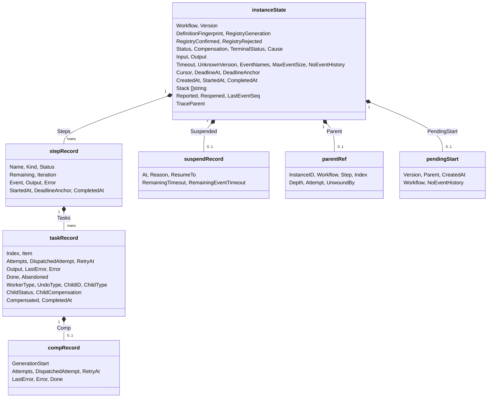
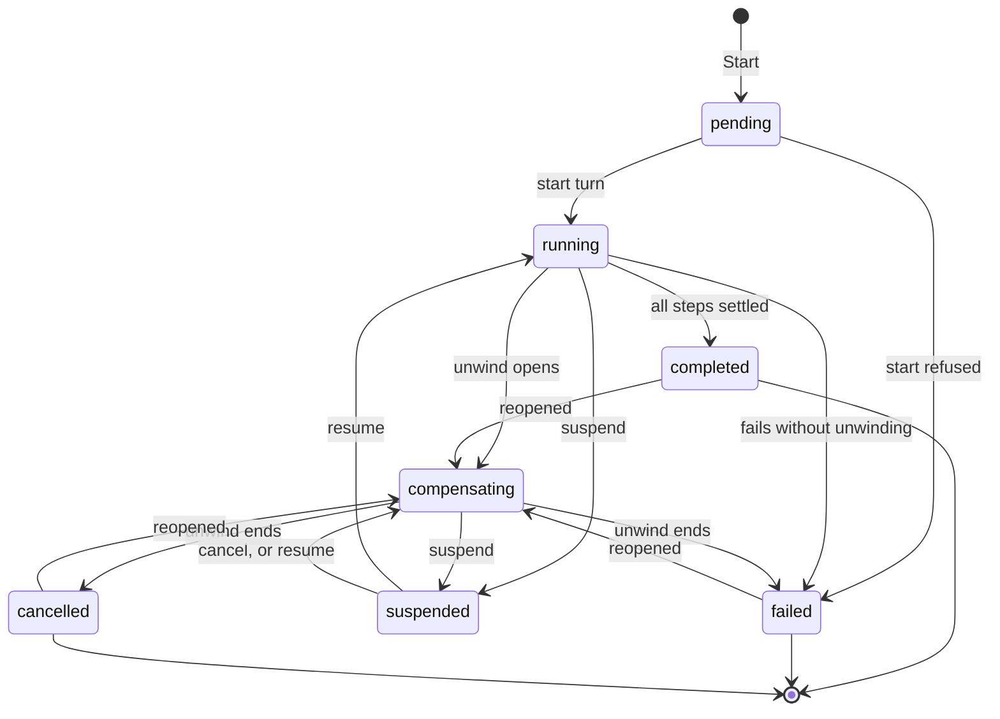
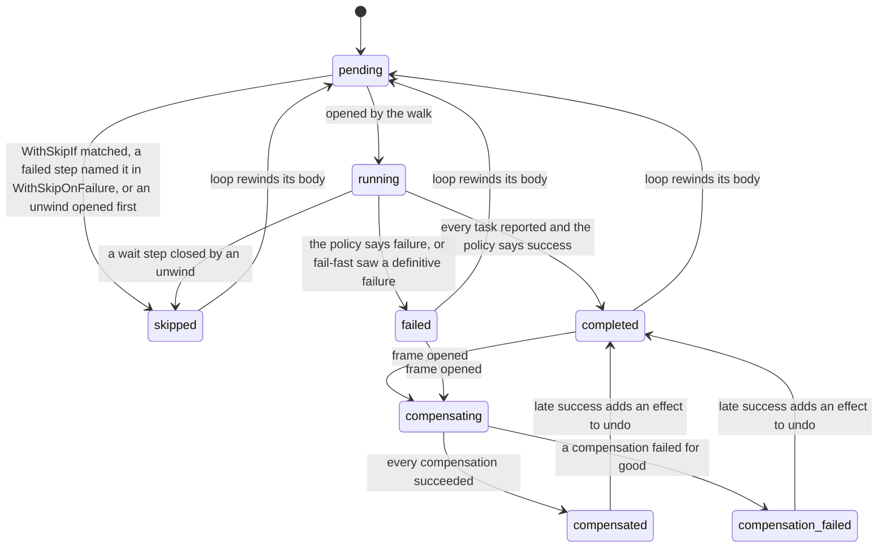
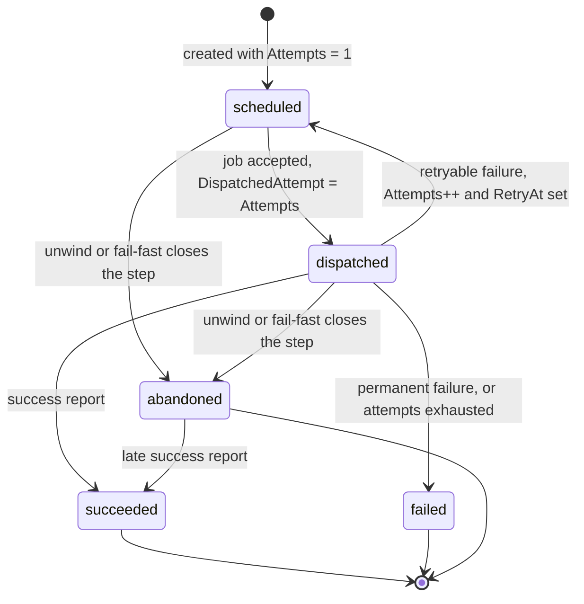

# 03. The journal

The journal is the orchestrator's actor state (`instanceState` in `journal.go`), and it is the single source of truth for an instance. Everything else, from what to dispatch next to what `GetStatus` returns, is derived from it.

## One document, rewritten whole

Every write replaces the entire journal in one `SetState` call, encoded as MessagePack. Writing one document is what makes a step transition atomic without transactions: a turn that records a task's output, settles the step, opens the next step, and numbers its first attempt lands all of that at once or none of it.

The same `SetState` call also carries:

- The **workflow labels** (status, version, parent instance ID, and creation time) that the provider indexes, which is what makes `List` a range scan on an indexed column rather than a walk of every journal (see [10](10-history-and-retention.md))
- The **history events** the write adds, appended to a separate store in the same operation (see [10](10-history-and-retention.md))
- The **TTL** of a terminated top-level instance, twice its retention, as a backstop for a purge sweep that never runs

Because the whole document is rewritten on every report, its size is capped by `WithMaxJournalSize` (1 MiB by default). `persist` measures the encoding before writing, and an instance whose journal would exceed the cap is failed without compensation, since an instance that cannot persist cannot progress, and an unwind would need more journal than there is room for. The encoding used for the size check is cached in `instanceState.encoded` and reused by `MarshalMsgpack`, so the journal is encoded once per write.

## Before the journal: the pending placeholder

`Start` does not create the journal. It dispatches the start job with `actor.WithInitialState`, which stores a placeholder state in the same atomic operation as the job, but only if the actor has no state yet. The placeholder has an empty `Status` and a `PendingStart` record with the version, the parent, the creation time, and the workflow name, and it carries the `pending` status label.

Everything that asks whether an instance has a journal checks `Status != ""`, so the placeholder is invisible to the engine's logic, while `List` and `GetStatus` can still describe the instance as pending. The first journal write, in the start turn, replaces it. If the start job ends without running, for example because it was deleted or failed permanently, the next deadline turn removes the orphaned placeholder, and until then `GetStatus` reports the instance as not found because it checks that a start job is still live.

## The records

### The instance

| Group | Fields | Notes |
| --- | --- | --- |
| Identity | `Workflow`, `Version`, `DefinitionFingerprint`, `RegistryGeneration`, `RegistryConfirmed`, `RegistryRejected` | Fixed at start. Every later turn refuses to run on a host whose definition has a different version or fingerprint (see [08](08-versions-and-registry.md)) |
| Lifecycle | `Status`, `TerminalStatus`, `Compensation`, `Cause`, `Output` | `TerminalStatus` is decided when an unwind opens, so a cancelled instance ends as cancelled rather than failed. `Compensation` is reported beside the terminal status rather than multiplied into more statuses |
| Policies snapshot | `Timeout`, `UnknownVersion`, `EventNames`, `MaxEventSize`, `NoEventHistory` | Copied from the definition at start, so a host that does not have this version can still apply the deadline policy, and a caller with a newer definition can still validate an event against this instance |
| Time | `CreatedAt`, `StartedAt`, `DeadlineAnchor`, `DeadlineAt`, `CompletedAt` | `StartedAt` is only ever reported. Deadlines are measured from `DeadlineAnchor` when it is set, which suspend, resume, and unwinds move (see [09](09-time-and-suspension.md)) |
| Graph state | `Steps`, `Stack`, `Cursor` | `Steps` has one record per top-level step, in definition order, created at start. `Stack` is the compensation stack by step name, oldest first. `Cursor` names the running or compensating step for display and is never read by the engine |
| Parent and child | `Parent`, `Reported`, `Reopened` | `Reported` stops a retried turn from reporting a termination to the parent twice. `Reopened` marks an instance that became active again after terminating, so metrics do not count it twice |
| Other | `Input`, `TraceParent`, `Suspended`, `LastEventSeq`, `PendingStart` | `LastEventSeq` is the last history event number written, so a retried turn numbers its events the same way |

Two fields are never persisted: `stepHistory` holds step settlements a turn overwrote before writing (see [10](10-history-and-retention.md)), and `encoded` caches the size-check encoding.

### Steps

A step record is created for every top-level step at start, including flattened loop body steps and loop nodes, so the journal alone can answer status queries and the unknown-version path. Parallel members are not steps: each member is a task of its group.

`Remaining` counts the tasks that have not reported, so checking whether a wide fan-out is done is O(1). `Iteration` counts how many times a loop rewound a body step, or how many times a loop node has evaluated its condition. `Event` holds the payload a wait step received, and `Output` holds what a loop node copied from its until step when it settled.

### Tasks

A task is one execution unit: one worker actor and its jobs, or one child instance.

| Step kind | Tasks | Task index |
| --- | --- | --- |
| `step`, `child` | One, created when the step opens | 0, or the iteration number for a loop body step, which appends one task per iteration |
| `parallel` | One per member | The member's position in the group |
| `foreach` | One per item of the upstream array | The item's position |
| `wait`, `loop` | None | |

The fields that matter most:

- `Attempts` is the number of the attempt that is scheduled or in flight. A new task starts at 1, and a failed attempt that will be retried increments it in the same turn that records the failure, before the next job exists. That is the invariant that lets a report always be matched against a known attempt (see [04](04-turns.md)).
- `DispatchedAttempt` records the latest attempt whose job was accepted, so a later turn does not dispatch it again. It may lag behind, because a turn that dispatched a single job saves the marker with the next write rather than paying for a write of its own.
- `RetryAt` is when the next attempt may run, passed to the job as its due time.
- `Done` with an empty `Error` is a success, and with an `Error` a definitive failure. `Abandoned` marks a task an unwind or a fail-fast closed out before it reported. An abandoned task counts as done, but a success it reports late is still recorded, because the attempt was never interrupted and its effect is real (see [07](07-compensation.md)).
- `WorkerType`, `UndoType`, `ChildID`, and `ChildType` are recorded when the task is created, so cancelling and purging its jobs never depends on which definition happens to be deployed later.
- `ChildStatus` and `ChildCompensation` keep a child's terminal outcome in the parent's journal after the child's own journal is purged.

### Compensations

`taskRecord.Comp` exists once the task's frame is being unwound, and has its own attempt counter, backoff, and dispatch marker, because compensations get a separate and more generous policy. `GenerationStart` fences out reports from compensation attempts dispatched before a late forward success replaced the record, which [07](07-compensation.md) explains.

## State machines

### Instance status

The transitions in more detail:

- **Start refused.** The start turn writes a terminal `failed` journal directly when the parent chain is deeper than `WithMaxDepth` or the input is larger than `WithMaxInputSize`.
- **Fails without unwinding.** A step failed under `WithSkipOnFailure`, the journal outgrew `WithMaxJournalSize`, the registry revoked the start's identity before anything was dispatched, or the deadline found no host serving the version under `FailUnknownVersion` (see [08](08-versions-and-registry.md)).
- **Unwind opens.** A step failed without `WithOptional` or `WithSkipOnFailure`, `Cancel` was called, or the instance or event timeout elapsed (see [07](07-compensation.md)).
- **Out of suspension into compensating.** `Cancel` wins over a suspension and opens the unwind at once. A resume also lands in `compensating` when the instance was suspended mid-unwind, or when a step that settled during the suspension opened one.
- **Unwind ends.** The stack emptied, the abort policy stopped at a failed frame, or the unwind's own budget elapsed. The instance ends with the `TerminalStatus` decided when the unwind opened: `cancelled` after a cancel or a parent's unwind, `failed` otherwise.
- **Reopened.** A terminated instance ignores every event except two: a parent's `unwind`, which reopens a child that terminated without unwinding, and the late success of a task the unwind abandoned, which reopens an instance that already unwound. A late report or a repeated cancel cannot revive it.

### Step status

The loop node itself goes `pending` to `pending` while it rewinds, then `completed` or `failed` once its condition holds or its iterations run out. A loop node never has a task, so it is never `running`.

### Task lifecycle

`succeeded`, `failed`, and `abandoned` are all `Done`, told apart by `Error` and `Abandoned`. A late report of a failure from an attempt older than `Attempts` is ignored, since a newer attempt is already in flight, while a late success from an older attempt is accepted, since the work was done.

## Reading a journal while debugging

- In tests built with the `unit` tag, `(*instanceState).Describe()` prints a journal with every step, task, and compensation, shortened values, and the compensation stack in unwind order.
- `DecodeInstance` in `management.go` decodes a stored journal or placeholder without a definition, which is how the management API and the dashboard show instances of versions no host serves.
- `statusView` builds the caller-facing `InstanceStatus` from the same records `advance` settles, so a caller never sees `completed` before every step, including optional ones, has reported.
