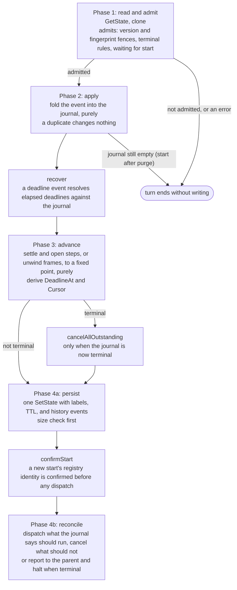

# 04. Turns

A turn is the orchestrator's single write path. Every change to an instance, whatever caused it, is one turn that folds one event into the journal. This document describes the phases of a turn, the invariants their order guarantees, and what happens when a turn fails partway through.

## What drives a turn

The orchestrator is an actor, so its turns are serialized by the actor's exclusive lock: two reports for the same instance are never folded at the same time. Status reads use `Peek`, which takes the shared lock, so they run concurrently with each other and only wait for a write turn in progress.

| Event | Arrives as | Sent by |
| --- | --- | --- |
| `start` | Job `start` | `WorkflowService.Start`, or a parent starting a child |
| `done` | Job `done` | A worker reporting a forward attempt, a worker's `JobFailed` reporting a transport failure, or a child reporting its termination |
| `compensated` | Job `compensated` | An undo worker reporting a compensation attempt, its `JobFailed`, or a child reporting the unwind its parent asked for |
| `event` | Job `event` | `WorkflowService.RaiseEvent` |
| `cancel`, `suspend`, `resume` | Jobs of the same names | `WorkflowService.Cancel`, `Suspend`, `Resume`, and the management API's control endpoint |
| `unwind` | Job `unwind` | A parent compensating this instance |
| `deadline` | Alarm `deadline` | The instance's own alarm (see [09](09-time-and-suspension.md)) |

`orchestrator.Job` decodes the job into an `event` (an unknown method or an undecodable payload fails the job permanently, since it would fail the same way on every attempt), authorizes a start against the registry (see [08](08-versions-and-registry.md)), and runs `turn`. If the turn says this host does not serve the instance's version, `Job` returns `actor.ErrJobRejected`, so Francis re-routes the job to another host without counting an attempt. `orchestrator.Alarm` first repairs dead-lettered deliveries and handles instances that are terminal, suspended, or still pending, and only then runs a turn with a `deadline` event.

## The four phases



### Phase 1: read and admit

The turn reads the committed journal and clones it, so nothing the turn does can mutate the state client's cached copy of the last write. `admits` then decides whether the turn runs at all.

| Situation | Outcome |
| --- | --- |
| The journal's version or fingerprint differs from this host's definition | `errVersionNotServed`, so the job is rejected and re-routed |
| A start whose payload's version, fingerprint, or registry generation conflicts with the journal or this host | `errVersionNotServed` |
| A terminal journal, for any event other than a parent's `unwind` | Not admitted, unless the registry has not confirmed the start yet, the event is the late success of an abandoned task, or the instance is a child that still owes its parent a report |
| No journal yet, for any event other than `start` | `errWaitingForStart`, an ordinary error, so Francis retries the job until the start has run; this is how a `Suspend` issued right after `Start` still lands |
| Anything else | Admitted |

The identity fences come before the terminal shortcut on purpose: a late result can reopen a terminal journal and dispatch compensations, and only a host that has this exact graph may do that.

An admitted journal written before fingerprints existed is bound once to this host's registered identity, and missing policy snapshots (`Timeout`, `UnknownVersion`) are filled from the definition, because a host whose definition matches may safely supply them.

### Phase 2: apply

`apply` in `advance.go` folds the event into the journal. It is a pure function: no I/O, no clock beyond the `now` it is given, no user code. It returns whether the event was a duplicate, meaning it changed nothing, which the `francis.workflow.turns.duplicate_events` counter records.

Deduplication is decided by the journal, never by remembering deliveries. A report counts if and only if the journal does not already have an outcome for that task attempt, so every report is safe to deliver any number of times.

| Event | What `apply` does |
| --- | --- |
| `start` | If the journal exists, nothing: a second start's input is discarded. Otherwise it creates the journal: the identity from the payload, status `running`, the policy snapshots, and one `pending` record per top-level step. A start whose parent chain is deeper than `WithMaxDepth`, or whose input exceeds `WithMaxInputSize`, becomes a small `failed` journal instead, so the failure reaches the parent as a report |
| `done` | Finds the step and task. A task that is already done ignores it, except for the late success of an abandoned task. A failure from an attempt older than the current one is ignored, since a newer attempt is in flight. A success records the output and closes the task. A failure closes the task when it is not retryable or attempts are exhausted, and otherwise numbers the next attempt and sets its `RetryAt` |
| `compensated` | The same for the task's compensation record, with its own attempt policy, and with reports from an earlier compensation generation ignored |
| `event` | Records the payload on the wait step listening for that event name, but only while that step is running. An event raised before its wait step opens, or after it completed, records nothing |
| `cancel` | Nothing while already compensating. Otherwise clears any suspension, since cancel wins over suspend, and opens an unwind that will end as `cancelled` |
| `unwind` | Sent only by a parent. Depending on the child's state it resumes a suspended unwind, re-reports an unwind that already finished, or reopens a terminated instance and opens an unwind with a fresh timeout budget (see [07](07-compensation.md)) |
| `suspend`, `resume` | Records or restores the suspension and shifts deadline anchors (see [09](09-time-and-suspension.md)) |
| `deadline` | Nothing. `recover` resolves which deadline elapsed directly against the journal, because one alarm stands for every deadline the instance has |

### Phase 3: advance

`advance` derives the next journal from the current one. Like `apply`, it is a pure function of the journal, the definition, and `now`, and it is the only place step and instance transitions happen.

```text
advance(journal):
    if terminal or no journal: return
    if suspended:
        settle steps whose tasks already reported, but open nothing
        keep the status suspended, updating ResumeTo if settling opened an unwind
        clear DeadlineAt so reconcile drops the alarm
        return
    repeat, at most advanceIterations(definition) times:
        changed = settleSteps
        if compensating:
            changed |= refreshFrames      push frames for effects discovered after the unwind opened
            changed |= unwindNextFrame    open, wait on, or pop the top frame, or terminate on an empty stack
        else:
            changed |= openNextStep       open the first pending step, or terminate when none is left
        stop when nothing changed or the instance terminated
    DeadlineAt = earliest of the instance deadline and the open wait's deadline
    Cursor = the running or compensating step
```

The loop runs to a fixed point because one transition often enables the next within the same turn: settling a step opens the next one, which may settle at once if its `WithSkipIf` matches, if it is a fan-out over an empty list, or if it is a loop node evaluating its condition. Steps open strictly one at a time, in definition order: `openNextStep` returns without opening anything while a step is running or compensating.

The bound, `4 * (steps + sum of maxIterations * len(body) over loops) + 16`, is derived from the graph rather than fixed, because each step opens and settles at most once going forward and once while unwinding, and a loop whose body settles without tasks can run every iteration inside one turn. A fixed bound shorter than the graph would leave pending steps that nothing opens, and the instance would run to its timeout.

`settleSteps`, `openStep`, and `unwindNextFrame` are described in [06](06-step-kinds.md) and [07](07-compensation.md).

### Phase 4a: persist

If `advance` made the journal terminal, `cancelAllOutstanding` first deletes the live jobs of every task that has not reported. A terminal status is never published while work it no longer wants could still start, and if the cleanup fails, the turn fails against the old journal and is retried.

`persist` then:

1. Copies the dispatch markers this activation is holding into the journal (see reconcile below).
2. Sets the listing labels and, for a terminal top-level instance, the TTL.
3. Derives the history events this write adds and numbers them after the committed journal's `LastEventSeq` (see [10](10-history-and-retention.md)).
4. Measures the encoding, and if it exceeds `WithMaxJournalSize`, fails the instance without compensation, cancels its outstanding work, and recomputes the labels and history for that terminal journal.
5. Writes everything in one `SetState`.

Every admitted turn writes the journal, even when its event was a duplicate, which is also how held dispatch markers eventually reach storage.

### Confirming a new start

`confirmStart` runs after the first journal write and before the first dispatch. A start carries a registry generation (see [08](08-versions-and-registry.md)), and until the registry confirms that generation is still current, nothing may run. If the registry has revoked it, the journal is rewritten as `failed` with every step skipped and no compensation, since nothing ran. Either outcome is written to the journal, so the decision is made once.

### Phase 4b: reconcile

`reconcile` is the only code that schedules work. It derives the set of jobs that should exist from the journal and makes it so, idempotently, so it is safe to run at any time and runs on every turn.

- A **terminal** journal reports to its parent if it has one and has not yet (see [05](05-dispatch-and-workers.md)), deletes the deadline alarm, and halts the activation.
- A **suspended** journal deletes the deadline alarm and dispatches nothing. Suspension is nothing more than this gate: the journal keeps recording what in-flight work reports, and only scheduling stops.
- Otherwise it arms the deadline alarm if `DeadlineAt` changed, then visits every step:
  - A `running` step dispatches every task attempt whose `DispatchedAttempt` is behind its `Attempts`, within the fan-out window: tasks are admitted in index order, skipping finished ones, until `WithMaxParallel` not-yet-finished tasks are admitted, and tasks already dispatched still occupy their slot.
  - A `compensating` step dispatches every compensation attempt that is behind, all at once, since the tasks of a frame had no order between them going forward.
  - Any other step cancels the live jobs of tasks that have not reported and of compensations that have not finished. A job already executing is not interrupted, so its late report is recorded like any other.

Each accepted dispatch produces a dispatch marker. When a turn dispatched at most one job, the marker is held in memory (`orchestrator.unsavedDispatches`) and saved with the next journal write, which saves a write on every step of a sequential workflow. If the activation is lost first, the next turn dispatches that one job again, and its idempotency key absorbs the duplicate while the first job is still live. When a turn dispatched several jobs, the markers are written right away, because losing them would dispatch a whole fan-out or compensation frame again.

## Ordering invariants

The order of the phases is what makes turns safe to retry and safe to interleave with crashes. These are the invariants the code relies on:

1. **The journal is durable before anything is scheduled.** `persist` precedes `reconcile`, so a lost dispatch is always recoverable, because the next turn's reconcile re-derives it from the journal. The reverse order could produce a worker result for an attempt the journal never recorded, an orphan nothing could account for.
2. **An attempt is numbered in the journal before its job exists.** `openStep` creates tasks with `Attempts = 1`, and `applyReport` increments `Attempts` in the same write that records the failure. So a report always names an attempt the journal knows, and comparing the report's attempt with the journal is enough to classify it as current, late, or duplicate.
3. **Reconcile is idempotent and runs on every admitted turn.** Including turns whose event was a duplicate, so a turn that persisted and then failed to dispatch is healed by the next delivery of anything.
4. **A terminal status is published only after outstanding work is cancelled.** So a terminal journal never coexists with queued jobs it no longer wants.
5. **A new start's identity is confirmed before its first dispatch.** So an operator's registry reset can never race a start into running work under a revoked identity.
6. **Frames are pushed in completion order and popped in reverse.** The saga invariant (see [07](07-compensation.md)).

## When a turn fails partway

| The turn fails | What is durable | How it recovers |
| --- | --- | --- |
| Reading the journal, or with `errWaitingForStart` | Nothing changed | Francis retries the job, up to 20 attempts starting 5s apart (the orchestrator's registration options) |
| In `cancelAllOutstanding` | Some jobs cancelled, the journal unchanged | The retried turn folds the same event into the same journal, reaches the same terminal state, and cancels the rest |
| In `persist` | The journal unchanged | The retried turn produces the same journal, since `apply` and `advance` are pure, and the same history events with the same numbers, since numbering starts from the committed journal |
| In `confirmStart` | The journal written, not yet confirmed | The retried start finds the journal, so `apply` records nothing, and confirmation runs again; a terminal journal is still admitted while unconfirmed |
| In `reconcile`, after some dispatches | The journal written, some jobs accepted | The accepted jobs' markers are held in the activation; the retried turn records nothing new, persists the held markers, and dispatches the rest |
| On every attempt, until the job is dead-lettered | The journal as of the last successful write | `JobFailed` arms the deadline alarm immediately and replays the job; the deadline turn retries any dead-lettered delivery it finds and reconciles in any case (see [05](05-dispatch-and-workers.md)) |

## A worked example

Take `list` (a plain step), then `resize` (a fan-out over `list`'s output with `WithMaxParallel(2)`), then `publish` (a plain step).

| Turn | Event | `apply` | `advance` | `reconcile` |
| --- | --- | --- | --- | --- |
| 1 | `start` | Creates the journal, all steps `pending` | Opens `list` with task 0, attempt 1 | Arms the deadline, dispatches `list[0]` attempt 1; one marker, held |
| 2 | `done list[0]#1`, output `["a","b","c"]` | Closes `list[0]` | Settles `list`, opens `resize` with tasks 0, 1, 2 holding items `a`, `b`, `c` | Window of 2 admits tasks 0 and 1 and dispatches both; two markers, so a second write saves them now |
| 3 | `done resize[1]#1`, success | Closes task 1, `Remaining` 2 | Nothing settles | The window admits tasks 0 (already dispatched) and 2, and dispatches task 2 |
| 4 | `done resize[0]#1`, retryable failure | Task 0 moves to attempt 2, `RetryAt` now + 2s | Nothing settles | Dispatches `resize[0]` attempt 2 with idempotency key `run\|2` and a due time of `RetryAt` |
| 5 | `done resize[1]#1` again | Task 1 is done, so a duplicate | Nothing | Nothing is behind, so nothing is dispatched |
| 6 | `done resize[2]#1`, success | Closes task 2, `Remaining` 1 | Nothing settles | Nothing |
| 7 | `done resize[0]#2`, success | Closes task 0, `Remaining` 0 | Settles `resize` as completed, opens `publish` | Dispatches `publish[0]` |
| 8 | `done publish[0]#1`, success | Closes `publish[0]` | Settles `publish`, terminates the instance as `completed` with `publish`'s output | Deletes the alarm and halts |

`resize`'s output, which `publish` reads, is the array of the three task outputs in item order.
