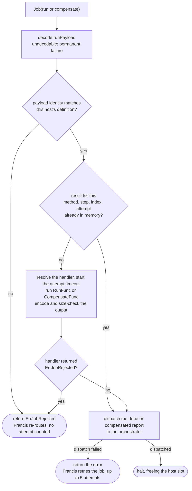

# 05. Dispatch and workers

`reconcile` turns the journal into jobs, and workers turn jobs into handler calls and reports. This document covers what a task's job carries, how a worker runs it, how retries and timeouts work, how every message is deduplicated, how dead letters are recovered, and how child instances are started and report back.

## What a task's job carries

`buildRunPayload` in `dispatch.go` builds a `runPayload` from the journal for one attempt. It carries only what the step declared it needs, so the engine never ships the whole journal to a worker, and a step's data dependencies can be audited from the definition alone.

| Field | Contents |
| --- | --- |
| `InstanceID`, `Workflow`, `Step`, `Index`, `Attempt` | The task's identity, which the report echoes back |
| `Version`, `DefinitionFingerprint`, `RegistryGeneration` | The journal's identity, so the worker can refuse a definition it does not have |
| `Handler` | For a parallel member, the member whose handler runs, since the step named in `Step` is the group |
| `Positional` | Whether `Index` means a position among siblings, which is true for groups and fan-outs; a plain step's handler sees `-1` from `Task.Index` |
| `Input` | The workflow input as given to `Start` |
| `Item` | The fan-out element of this task |
| `Outputs`, `Skipped` | The upstream outputs this task may read, and which of them were skipped |
| `Result`, `Cause` | For a compensation only: the forward task's output and the reason for the unwind |
| `OrchestratorType` | Where to send the report |
| `MaxOutputSize` | The output cap, enforced on the worker |
| `TraceParent` | The `Start` call's trace context, which every span of the instance links to |

### What a task may read

`upstreamOutputs` decides the `Outputs` map:

- The output of the **preceding top-level step**, except for a fan-out whose `WithItemsFrom` names that step: each task already gets its own item, and shipping the whole array to every task would multiply its size by the fan-out width.
- The outputs of the steps named by the step's **`WithInputFrom`**.
- For a parallel member, also the steps named by the **member's own `WithInputFrom`**.

A skipped upstream step is listed in `Skipped` with a nil output, so `Task.DecodeOutput` can return `ErrStepSkipped` rather than decoding nothing, and a step that is not in the map returns `ErrStepNotFound`. What a step's output is depends on its kind, as [06](06-step-kinds.md) describes.

## How a worker runs an attempt

- **Identity fence.** A payload with a fingerprint is checked locally against this host's version and fingerprint. A payload without one was dispatched by an engine version that predates fingerprints, and is checked against the registry instead (see [08](08-versions-and-registry.md)).
- **Memoized result.** The worker keeps the result of the last attempt it ran for the life of its activation, keyed by method, step, index, and attempt. If dispatching the report fails, the job fails and Francis retries it, and the retry re-sends the memoized result rather than running the handler again. If the activation is lost in between, the handler does run again, which is one of the reasons handlers must be idempotent.
- **Attempt timeout.** `WithAttemptTimeout` and `WithCompensateTimeout` start when the worker invokes the handler, after Francis has assigned capacity, so time spent waiting in a queue or in retry backoff never consumes the budget. A handler that returns after its deadline still fails the attempt, even if it ignored the cancelled context and returned a value.
- **Output cap.** The output is JSON-encoded and checked against `WithMaxOutputSize` on the worker, so the orchestrator never spends a turn on something unbounded. An output that cannot be encoded or is too large fails the attempt permanently, since it would fail the same way every time.
- **Report.** The report carries the output or the error, whether another attempt could succeed, and the worker's own start and finish times, which the event history records (see [10](10-history-and-retention.md)).

### How handler errors are classified

| Handler outcome | Report | Effect in the journal |
| --- | --- | --- |
| Returns a value and no error | Success | Task done, output recorded |
| Returns an ordinary error | Failure, retryable | Another attempt if any are left, otherwise the task fails |
| Exceeds its attempt timeout | Failure, retryable, `attempt timeout elapsed after ...` | The same as an ordinary error |
| Returns an error wrapping `actor.ErrJobPermanentFailure` | Failure, not retryable | The task fails at once |
| Output too large or not encodable | Failure, not retryable | The task fails at once |
| Returns `actor.ErrJobRejected` | No report | The job is re-routed to another host and no attempt is counted |

Attempts are owned by the engine and counted in the journal, independently of Francis's own job retries. A worker returns an error to Francis in exactly one case, when dispatching its report failed, which is why the worker types register only 5 job attempts.

### Backoff

A failed attempt that will be retried gets `RetryAt = now + backoff`, and the next job is dispatched with that due time. The delay before attempt `n` is `initial * 2^(n-2)`, capped at the maximum: with the defaults of 2s and 1m, attempts 2, 3, 4, and 5 wait 2s, 4s, 8s, and 16s. Compensations use the same shape with their own defaults of 10s and 10m, counting attempts within the current compensation generation.

## Idempotency keys

Every job the engine dispatches carries an idempotency key. A key is scoped to the target actor, and two dispatches with the same key to the same actor produce one job as long as the first is still live: the provider stores jobs with first-write-wins on `(actor type, actor ID, key)`, and a job that completed or dead-lettered no longer holds its key. So a key deduplicates a re-dispatch of a message still in flight, and the journal deduplicates everything else.

| Message | Target actor | Key |
| --- | --- | --- |
| Start an instance | `workflow.<name>` at the instance ID | `start` |
| Run attempt `a` | Worker at `<instance>\|<step>\|<index>` | `run\|<a>` |
| Compensate attempt `a` | Undo worker at the same ID | `compensate\|<a>` |
| Forward report | Orchestrator | `done\|<step>\|<index>\|<a>` |
| Compensation report | Orchestrator | `comp\|<step>\|<index>\|<a>` |
| Report from a dead-lettered attempt | Orchestrator | The report key plus `\|dl` |
| Raise event `e` | Orchestrator | `event\|<e>` |
| Cancel, suspend, resume | Orchestrator | `cancel`, `suspend`, `resume` |
| Ask a child to unwind, for the parent's compensation attempt `a` | Child orchestrator | `unwind\|<a>` |
| A child's result | Parent orchestrator | `done\|<step>\|<index>\|<parent task attempt>` |
| A child's unwind outcome | Parent orchestrator | `comp\|<step>\|<index>\|<parent compensation attempt>` |

A few consequences follow from the keys:

- A repeated `Cancel` while the first is still queued coalesces with it, and a later one after it ran is a no-op in `apply`.
- Raising the same event twice while the first job is queued delivers it once. Raising it after the first job ran delivers it again, and `apply` records it only if a wait step for that name is open, which is how a wait inside a loop receives one event per iteration.
- Starting with `WithInstanceID` is idempotent only while the instance exists: `Start` reads the journal first and returns `created == false` for an existing one, and the start job's key deduplicates concurrent starts, but an instance ID whose journal was purged starts a new instance.

## Where duplicates come from, and what absorbs them

Execution is at-least-once everywhere, so the engine is designed to absorb every kind of duplicate:

| Duplicate | Absorbed by |
| --- | --- |
| A turn retried after it persisted, re-dispatching its jobs | The jobs' idempotency keys, or, if the first job already ended, the journal, which records the second report as a duplicate |
| A report delivered twice | `apply`: the task already has an outcome |
| A report for an attempt older than the current one | `apply`: a late failure is ignored and a late success is recorded, since the work was really done |
| A worker activation lost after running the handler but before reporting | Nothing: the handler runs again on retry, which is why handlers must be idempotent |
| A dispatch marker lost with the activation | The idempotency key of the re-dispatched job, while the first is still live |

## Dead letters

A job that exhausts its Francis-level attempts is dead-lettered, which removes it from the live set but keeps its record. Both sides of the engine react to that.

- **A worker's job.** The worker's `JobFailed` dispatches a report for that attempt with `Transport: true` and `Retryable: true`, keyed with a `|dl` suffix so it never collides with a real report. The orchestrator records it as a retryable failure, so the attempt budget decides whether the task is tried again. This is best-effort, and it is the only fast path, since a dead-lettered job takes its payload with it.
- **An orchestrator's job.** The orchestrator's `JobFailed` increments `francis.workflow.task.transport_failures`, arms the deadline alarm to fire immediately, and, for a delivery that can safely be replayed (a start, a report, an event, or a control request, and not a permanent failure), retries the dead-lettered job with its original payload.
- **The repair loop.** Every deadline turn starts by listing the orchestrator's jobs and retrying any replayable dead-lettered delivery it finds. The deadline alarm is recurring, so a repair that fails is retried 5s later. This is what recovers a delivery whose best-effort `JobFailed` callback itself failed.

## Child instances

A child step's task, and each task of a child fan-out, is a whole instance of another definition rather than a worker job.

**Starting a child.** `startChild` dispatches a start job to `workflow.<child>` at a child instance ID equal to `<parent instance>|<step>|<index>`, so a retried turn finds the same child instead of starting another. The start payload carries:

- The child's input: the task's item for a fan-out, otherwise the preceding step's output, falling back to the parent's own input
- The child's identity from its own registry, cached like any other start (see [08](08-versions-and-registry.md))
- A `parentRef` with the parent's instance ID, workflow, step, task index, the chain depth, and the parent task's attempt
- A pending placeholder whose labels name the parent, so `List(Parent: id)` shows children whose start has not run yet

**Refusing a child.** The child's start turn refuses a depth greater than its own `WithMaxDepth`, which is the only thing that stops a definition that references itself, and an input larger than its own `WithMaxInputSize`, since child starts bypass the service's encoder. A refused child becomes a terminal `failed` journal, so the refusal is reported to the parent like any other failure.

**Reporting back.** When a child terminates, its reconcile calls `reportToParent`, which dispatches a `done` report keyed by the parent task's attempt, carrying the child's output if it completed, or an error naming its terminal status and cause otherwise, plus `ChildStatus` and `ChildCompensation`. It then sets `Reported` and writes the journal, so a retried turn does not report twice. A child that did not complete fails the parent's task without another attempt, because the child ID is fixed and a retry would only find the same terminated instance. If the parent asked the child to unwind, the child reports a `compensated` instead, keyed by the parent's compensation attempt (see [07](07-compensation.md)).

**Keeping children around.** A terminated child's journal gets no TTL, because its parent may ask it to undo itself for as long as the parent is running. It is removed by the parent's purge, which purges children first, or by the sweep once its parent's journal is gone (see [10](10-history-and-retention.md)).
