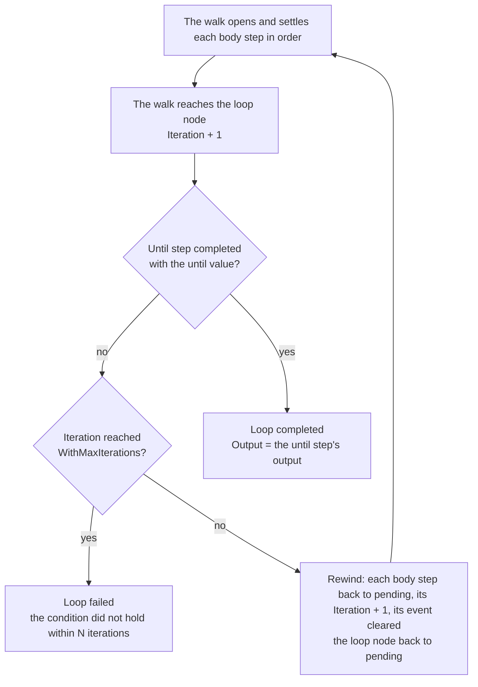

# 06. Step kinds

The walk in `advance` treats every top-level step the same way: it opens the first pending step, waits for it to settle, and moves on. What differs between kinds is what opening creates, when the step settles, and what it exposes as its output. This document covers each kind, then the conditions and policies that decide whether a step runs and what its failure costs.

## Summary

| Kind | Tasks created when it opens | Settles when | Output later steps read |
| --- | --- | --- | --- |
| `step` | One, running `WithRun` on a worker | Its task has a definitive outcome | The task's output |
| `parallel` | One per member, each running that member's handler or starting that member's child | Every task reported, or fail-fast saw a definitive failure | An object keyed by member name |
| `foreach` | One per element of the upstream array, running `WithRun` or starting a child per item | Every task reported, or fail-fast saw a definitive failure | An array in item order |
| `child` | One, which starts a child instance | The child reported its termination | The child's output |
| `wait` | None | Its event was recorded | The event's payload |
| `loop` | None | Its condition held, or its iterations ran out | The output of its until step |

In a group's or a fan-out's output, a task that failed stands as `{"error": "<message>"}` and a task without an output as `null`, so the next step can see which slots failed under `collect-failures` or `tolerate-failures`.

## How a step opens and settles

`openStep` first applies the conditions described below, which can record the step as skipped without opening it. Otherwise it stamps `StartedAt`, marks the step `running`, and creates its tasks, each with attempt 1 and with its worker, undo, or child actor references recorded (`configureTaskActors`), so cleanup never depends on the definition deployed later.

`settleSteps` runs on every iteration of `advance` and looks at each running step:

- A wait step settles as completed once its `Event` is set.
- Any other step waits until `Remaining` reaches zero, unless its policy is `fail-fast` and one of its tasks has failed for good. In that case it settles at once, and the tasks still outstanding are **abandoned**, not failed. Abandoning closes them in the journal without interrupting anything already executing, and a success one of them reports late is still recorded and compensated (see [07](07-compensation.md)).
- `stepOutcome` then decides between completed and failed. A plain or child step fails when its current task failed. A group or fan-out fails when any task failed, unless its policy is `tolerate-failures`.
- A completed step is pushed on the compensation stack if it has something to undo. A failed step is pushed too when any of its tasks has an effect to undo, such as the members of a fail-fast group that succeeded before another failed, and then `failStep` decides what the failure costs.

## Failure policies

`WithFailurePolicy` applies to groups and fan-outs, and defaults to `fail-fast`.

| Policy | Settles | Step outcome | Outstanding tasks |
| --- | --- | --- | --- |
| `fail-fast` | At the first definitive task failure | Failed | Abandoned: jobs that have not started are cancelled, and jobs already executing finish and report |
| `collect-failures` | When every task has reported | Failed if any task failed | None, every task runs to completion |
| `tolerate-failures` | When every task has reported | Completed regardless | None, and the failures are visible in the step's output |

Each task of a group follows its own member's attempt and backoff policy, and each task of a fan-out follows the fan-out's policy. A task fails definitively only after its attempts are exhausted or it failed permanently.

## Plain steps

A plain step has exactly one task with index 0, running on the worker queue of its required capability, or the base queue. Inside a loop body it gains one task per iteration, described below.

## Parallel groups

`Parallel` creates one task per member, at the member's index. A member is a plain or child step, never a group, fan-out, or loop, so a group is always a single unwind unit. Each member carries its own handler, compensation, attempt, backoff, timeout, capability, and `WithInputFrom`, while conditions, optionality, skip-on-failure, and the failure policy belong to the group. No member can read another member's output, since `WithInputFrom` only names top-level steps that ran before the group.

## Fan-outs

`ForEach` reads its items when it opens: it decodes the output of the step named by `WithItemsFrom` as a JSON array, and stores each element in its task's `Item`. The list is journaled at that moment, so a retried turn re-reads the recorded items rather than deriving them again, and the fan-out's width is an output of a step rather than a callback the orchestrator runs.

- A source step that was **skipped** gives an empty fan-out, which settles as completed in the same turn.
- A source output that is **not a JSON array** fails the fan-out step, as its own input being unreadable, rather than crashing the instance.
- `WithMaxParallel` bounds how many tasks of this instance are in flight, as a window that slides over the tasks in index order (see [04](04-turns.md)). It is separate from `WithConcurrency`, which bounds how much work a host accepts across every instance.
- A fan-out with `WithChild` starts one child instance per item, with the item as the child's input.

## Child steps

A child step's single task starts an instance of another definition (see [05](05-dispatch-and-workers.md)). The child keeps its own journal and history, and only its outcome enters the parent's journal. A child that ends as anything but completed fails the task without another attempt, because the child's ID is derived from the parent's and a second attempt would find the same terminated instance.

## Wait steps

A wait step has no task. It opens, and stays running until `RaiseEvent` delivers the event it listens for, which defaults to the step's name.

- **Only the open wait accepts its event.** An event raised before the wait step opens, or after it completed, is recorded as a duplicate and dropped. Callers that may raise early have to retry, or the definition has to open the wait sooner.
- **Event names are unique** within a definition, so an event can never be ambiguous about which step it belongs to.
- **The event contract is in the journal.** `RaiseEvent` validates the event name against the journal's `EventNames` and its size against `MaxEventSize` (the definition's `WithMaxOutputSize`), so a service built from a newer definition can still raise events on an instance of an older version.
- **While suspended**, an event is still recorded and the wait step settles, but the next step only opens on resume.
- **`WithEventTimeout`** bounds the wait. When it elapses, the instance unwinds with `event "<name>" timed out` as its cause (see [09](09-time-and-suspension.md)).

## Loops

A loop is a control node with no task. Its body steps are ordinary top-level steps that precede it in the walk (see [02](02-definitions-and-ir.md)), so the walk reaches the loop node only after an iteration's body has settled. The loop node then decides, in `openLoop`, whether to finish or rewind.

- **The condition is a recorded output.** `WithUntil` names a body step and a boolean, and the loop ends once that step completed with that value. A body step that failed or was skipped did not decide anything, so the loop repeats. The condition is checked only after an iteration, so a loop that starts runs its body at least once.
- **Every iteration is a new task.** A body step appends one task per iteration, and its task index equals its iteration, so each iteration has its own worker actor (`<instance>|check|0`, `<instance>|check|1`, and so on) and its own idempotency keys. The tasks of earlier iterations stay in the journal, because their effects are real and an unwind has to undo every one of them. The step's outcome and output come from the current iteration's task.
- **Rewinding preserves history.** Before a body step's record is reset, `captureStepHistory` keeps a copy of its settlement, so the event history still shows how each iteration ended (see [10](10-history-and-retention.md)).
- **The bound turns a stuck condition into a failure** rather than letting the instance run to its timeout. `WithOptional` and `WithSkipOnFailure` on the loop decide what that failure costs, exactly as for any other step.
- **A wait step in a body** needs a fresh event every iteration, since rewinding clears the one it received.
- **`WithSkipIf` on a loop** is checked when the walk first reaches the loop's first body step, before anything of the loop has run, and skips the loop together with its body. That is why its condition must name a step before the loop's body.

## Conditions and what a failure costs

### `WithSkipIf`

A condition is a step that returns a boolean, not a predicate the orchestrator evaluates, so the decision is a recorded output the journal can show. When the walk opens a step with `WithSkipIf(step, value)`, the step is recorded as skipped if the named step completed with exactly that boolean output. An absent output, an output that is not a boolean, or a named step that failed or was skipped all leave the decision unmade, and the step runs.

### `WithOptional` and `WithSkipOnFailure`

`failStep` decides what a step's failure costs:

| The failing step declares | Unwind | Effect on other steps | Instance ends |
| --- | --- | --- | --- |
| Neither | Yes, with the step's failure as the cause | Pending steps are skipped by the unwind | `failed`, after compensation |
| `WithOptional` | No | None | `completed`, if nothing else failed |
| `WithSkipOnFailure(names...)` | No | The named steps are recorded as skipped if still pending; skipping is not transitive | `failed`, without compensation |

Skipped dependents do not apply their own `WithSkipOnFailure` lists, since a skipped step is not a failed one.

## The instance's output

When a run reaches the end without unwinding, `terminate` sets the instance's output: the output of the step named by `WithOutput`, or otherwise the output of the last completed step that produced one, searching backwards. That is also what a child reports to its parent. An instance that unwinds before completing has no output.
