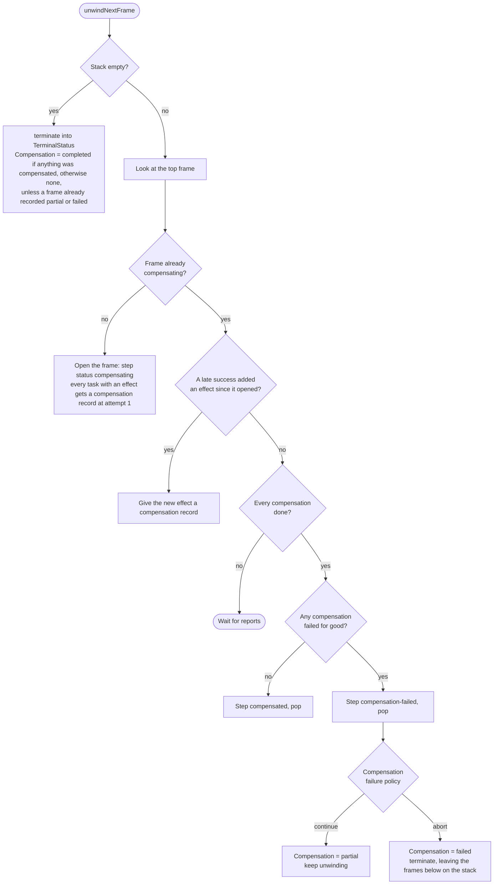
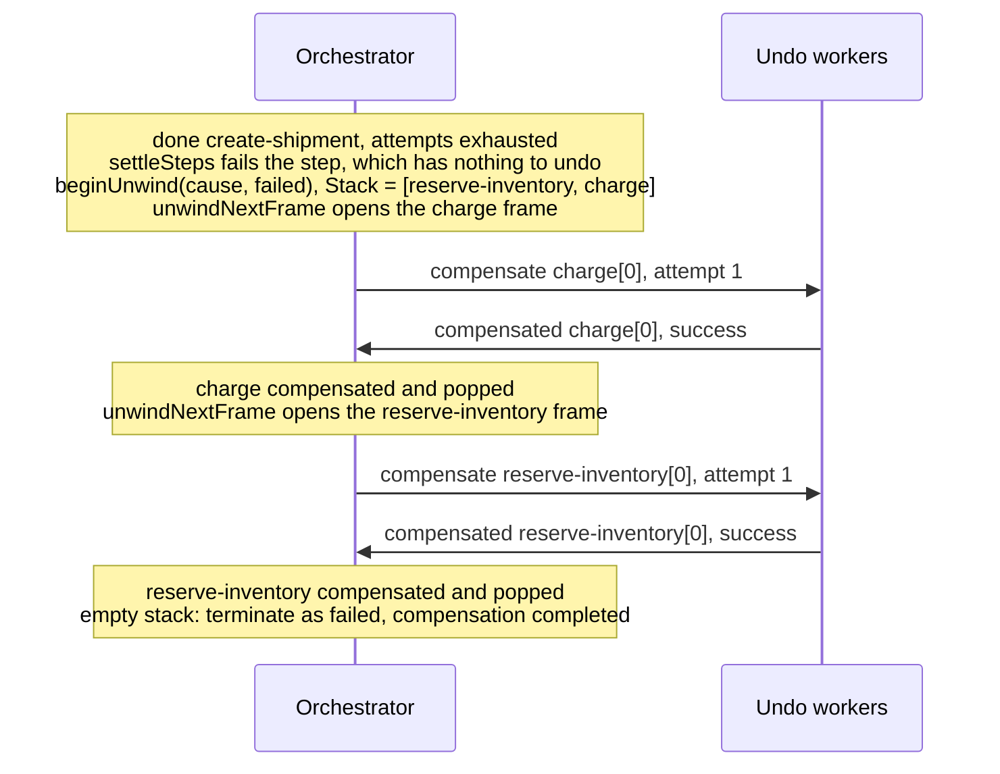

# 07. Compensation

The engine implements the saga pattern: every settled step that has an effect to undo is pushed on a compensation stack, and when the instance has to unwind, the stack is popped in reverse order and each frame's compensations run before the next frame starts. This document covers what opens an unwind, how frames are built and unwound, what a failed compensation costs, how late successes are handled, and how children are unwound.

## What opens an unwind

`beginUnwind` opens the compensation phase. It records the cause, which every compensation receives through `Compensation.Cause`, and the terminal status the instance ends with once the unwind is over, so a cancelled instance is not reported as merely failed.

| Trigger | Cause | Ends as |
| --- | --- | --- |
| A step failed, without `WithOptional` or `WithSkipOnFailure` (including a loop that ran out of iterations and a fan-out whose items were unreadable) | `step "<name>" failed: <error>` | `failed` |
| `Cancel` | The given reason, or `cancelled` | `cancelled` |
| A parent unwinding this child | The parent's cause, or `unwound by parent` | `cancelled` |
| The instance timeout elapsed | `instance timeout elapsed` | `failed` |
| A wait step's event timeout elapsed | `event "<name>" timed out` | `failed` |

When the unwind opens, every step still `pending` is recorded as skipped, and the step that was `running` is closed out by `abandonRunningStep`:

- A wait step is skipped, since nobody is going to raise its event now.
- Any other step has its outstanding tasks **abandoned**, then settles on the records as they stand, so whatever already succeeded still enters the stack.

Abandoning a task closes it in the journal without interrupting it. A job that has not started is cancelled by reconcile, but an attempt already executing runs to completion, and its report is still processed (see [late successes](#late-successes) below).

## Frames

`pushFrame` adds a settled step to the stack when both of these hold:

1. The step is compensable: it has `WithCompensate`, it is a child step, it is a fan-out of children, or it is a group with at least one compensable member.
2. At least one of its tasks has an effect to undo, according to the table below.

Frames are pushed in completion order, so the stack records the order effects happened in, and a step that is already on the stack or already unwound is never pushed again.

| Task outcome | Has an effect to undo |
| --- | --- |
| Succeeded | Yes, if the member or step that ran it is compensable |
| Failed | Only if the step or member declared `WithCompensateOnFailure`, since by the saga convention a step that did not complete did not take effect |
| Abandoned, having started a child | Always, since the child is a live instance and nothing but this frame will stop it |
| Abandoned, on a worker | No, until it reports a late success |

## Unwinding the stack

During an unwind, each iteration of `advance` calls `refreshFrames` and then `unwindNextFrame`.

- **One frame at a time, in reverse.** A frame is fully compensated before the next one starts, which is the point of unwinding in reverse: the effect that happened last is undone first.
- **Concurrently within a frame.** Reconcile dispatches every compensation of the open frame at once, since the tasks of one step had no order between them going forward.
- **On the undo queues.** Compensations run on `workflow.<name>.undo`, or on the undo queue of the capability the forward task required, since an undo almost always needs the placement its forward task had. The undo queues have their own per-host budget, `WithCompensateConcurrency`.
- **With the forward result.** The compensation's payload adds the forward task's output, readable with `Compensation.DecodeResult`, and the unwind's cause.
- **With their own policy.** Compensations get their own attempts and backoff (10 attempts, 10s doubling to 10m, by default), because a failed rollback leaves the system inconsistent and is worth trying harder than the forward work was.

### The outcome

`Compensation` is reported beside the terminal status, so `failed` always means the same thing and how far the rollback got is reported separately.

| Outcome | Meaning |
| --- | --- |
| `none` | Nothing needed unwinding, or the instance terminated without an unwind |
| `completed` | Every frame was compensated |
| `partial` | Some frames failed to compensate, and the rest were unwound (`ContinueUnwinding`, the default) |
| `failed` | The unwind stopped at a failed frame (`AbortUnwinding`), or ran out of time; the frames left on the stack name exactly what was not undone |

## An example

A `checkout` with `reserve-inventory` and `charge`, both compensable, and `create-shipment`, which fails for good:

## Late successes

Abandoning never interrupts an attempt that is already executing, so a task the unwind closed out can still report success. That work really happened, and ignoring the report would strand its effect, so `applyReport` treats a success from an abandoned task as a real outcome:

1. The task is un-abandoned and its output recorded.
2. If the task already had a compensation record, from an undo dispatched before this success, that record is replaced by a new one whose `GenerationStart` is the next attempt number. Reports from the older undo attempts are then ignored, because an undo that ran before the forward attempt finished cannot have covered what that attempt did afterwards.
3. A frame that had already closed goes back to `completed`, so it can open again.
4. If no unwind ever started, which happens when a fail-fast step was optional, the frame is pushed and kept for a possible later unwind by a parent.
5. If the instance had already terminated after an unwind, and the task has something to undo, the journal is reopened into `compensating`, with a fresh timeout budget and its compensation outcome recomputed from the records.

`refreshFrames` then pushes the step back on top of the stack, since its effect completed last, and `unwindNextFrame` allocates a compensation for the new effect. A terminated journal admits exactly this one kind of report for this reason (see [04](04-turns.md)).

## Unwinding children

Compensating a child task means asking the child to undo itself, rather than running a handler. Reconcile sends the child an `unwind` job carrying the parent's cause and its compensation attempt number, keyed by that attempt. The child records the highest attempt it was asked for in `Parent.UnwoundBy`, and its `applyUnwind` handles every state it may be in:

| The child is | What `unwind` does |
| --- | --- |
| Running or suspended | Clears any suspension and opens its own unwind, ending as `cancelled` |
| Suspended while compensating | Resumes the unwind already under way |
| Already compensating | Only records the newer attempt, so the eventual report lands on the parent's latest record |
| Terminated after an unwind of its own | Re-reports its recorded outcome, without relabeling a failed rollback as a success |
| Terminated without an unwind, for example completed | Reopens: clears its terminal outcome and opens an unwind with a fresh timeout budget, ending as `cancelled` |

When the child's unwind terminates, it reports to the parent with a `compensated` job keyed by the `UnwoundBy` attempt, instead of the `done` report an ordinary termination sends. The report is a success unless the child's own compensation outcome was `partial` or `failed`. This is why a completed child's journal has no TTL: as long as its parent is running, the parent may still ask it to undo itself.

## Running out of time while unwinding

The instance timeout bounds the unwind too, and which budget the unwind gets depends on what opened it:

- An unwind opened by a step failure or by `Cancel` runs within what is left of the instance timeout.
- An unwind opened by the instance timeout itself gets a fresh budget of the same size, by moving `DeadlineAnchor` to the moment the unwind opened, since the forward budget is already spent. So does an unwind a parent asks for, and a terminated journal reopened by a late success.

If the budget elapses while the instance is still compensating, the unwind is abandoned: the cause gains `unwind abandoned: instance timeout elapsed`, the outcome becomes `failed`, and the instance terminates with the unfinished frames left on the stack for an operator to finish by hand.
