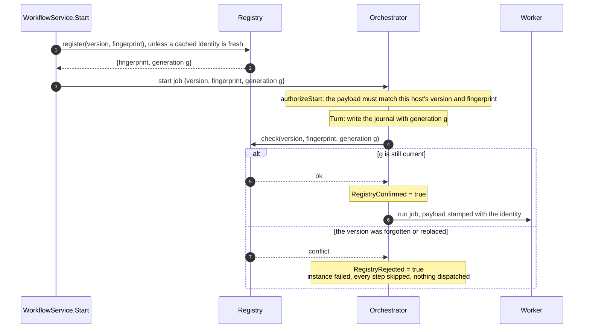

# 08. Versions and the registry

A running instance refers to its steps by name, and every host that touches it must agree on what those names mean. `WithVersion` names a definition, the fingerprint (see [02](02-definitions-and-ir.md)) says exactly what it contains, and the registry makes sure a version number means one fingerprint across the whole cluster. This document covers the registry, the identity a start carries, the fences that keep a host from driving a journal whose graph it does not have, and how rolling deployments drain.

## The registry

Each workflow registers a singleton actor, `workflow.<name>.registry`, whose state is a list of entries:

| Field | Meaning |
| --- | --- |
| `Version` | The version number |
| `Fingerprint` | The fingerprint first recorded for that version |
| `FirstSeenAt` | When it was recorded |
| `Generation` | The identity generation granted to that entry |

The registry never overwrites an entry, so the first deployment of a version defines it, and every later host whose fingerprint differs is told there is a conflict (`ErrDefinitionConflict`, the `francis.workflow.definition.conflicts` counter, and an error log asking for a version bump). `NextGeneration` survives every reset, so a generation once revoked can never become current again.

| Method | Called with | Lock | Does |
| --- | --- | --- | --- |
| `register` | `Invoke` | Exclusive | Records an unknown version with a new generation, upgrades a legacy entry without one, or reports whether the caller's fingerprint matches; with a generation, confirms that exact identity is still current |
| `check` | `Peek` | Shared | Reports the existing decision for a version without creating one, so established versions do not serialize every confirmation |
| `definitions` | `Invoke` | Exclusive | Lists the entries, which `WorkflowService.Definitions` returns |
| `forget` | `Invoke` | Exclusive | Removes a version that has no journals left, optionally replacing it with the caller's fingerprint under a new generation |

The singleton moves when hosts join or leave, so every call to it goes through `retryWhilePlacementMoves`. During a rolling deployment the singleton may land on an older host without the `check` method, in which case callers fall back to `register`.

## The identity a start carries

A start is authorized before its journal exists, and confirmed after its journal is written but before any of its work is dispatched. The generation is what connects the two.

Why two steps: `ForgetVersion` refuses a version that still has journals, and checks that under the registry's exclusive lock. A start whose job was already in flight when the version was forgotten has no journal yet, so the check cannot see it. That start writes its journal afterwards, but its confirmation then finds the generation revoked, and it fails before running anything. Confirmation is ordered after the first journal write precisely so that a reset either sees the journal or revokes its generation, with no cross-actor transaction.

Every host caches its start identity per `actor.Service` for 5 minutes (`startIdentityCacheTTL`), so a busy host does not send every start through the singleton. The cache is only used for new starts, whose first journal write is fenced by confirmation anyway, and a confirmation that finds the generation revoked evicts it. Child starts use the child definition's cached identity in the same way.

## The fences

A host that does not have the instance's exact graph never advances it. Each place that could act on an instance checks the identity it carries:

| Where | Checks | On mismatch |
| --- | --- | --- |
| `WorkflowService.Start` | That this host's fingerprint is the one registered for its version | `ErrDefinitionConflict` to the caller |
| `orchestrator.authorizeStart` | The start payload's version and fingerprint against this host's | The job is rejected and re-routed to another host |
| `orchestrator.admits`, on every turn | The journal's version and fingerprint, and a start's generation against the journal's | The job is rejected and re-routed; for the deadline alarm, the unknown-version policy applies |
| `orchestrator.confirmStart` | The start's generation is still current | The instance fails without running anything |
| `worker.Job` | The payload's version and fingerprint against this host's | The job is rejected and re-routed |

Rejection uses `actor.ErrJobRejected`, which declines the job on this host without counting an attempt, so Francis delivers it to a host that has the version. Nothing dead-letters because the wrong host picked it up first.

## Rolling deployments

The version is stamped on every instance at start, so a deployment that bumps the version runs both graphs side by side: new instances start on hosts with the new code, and old instances keep being routed, through rejections, to hosts that still have the old version. An operator watches the drain with `List(Version: old)` and retires the old hosts once it is empty.

Changing only a handler's body does not change the fingerprint, so hosts with the old and new handler code can serve the same version, and an instance's tasks may run on either.

## When no host has the version

Jobs for a version no host serves wait to be re-routed, but the deadline alarm fires on whichever host holds the orchestrator, and a turn there refuses to run. `handleUnknownVersionDeadline` then works from the journal alone, which is why the journal snapshots `Timeout` and `UnknownVersion` at start:

| Policy | Behavior |
| --- | --- |
| `ParkUnknownVersion` (default) | Re-arm the alarm 10 minutes out (`defaultParkInterval`) and wait for a host that can serve the version |
| `FailUnknownVersion` | Once the instance's own timeout has elapsed, fail it with cause `unknown version <n>`, skip its pending and running steps, and cancel its outstanding work, without compensation, since no host can run the compensations either |

## Forgetting a version

`ForgetVersion` is the repair for a version registered with the wrong graph, for example after a deployment that forgot to bump. It lists the instances labelled with that version, refuses with `ErrVersionInUse` if any of them has a journal (placeholders do not count, since their starts are fenced by their generation), and removes the entry. Forgetting the version this host itself serves replaces the entry with this host's fingerprint under a new generation in the same exclusive turn, so an older deployment cannot reclaim the number in between, and then clears the host's cached start identity.

## Legacy journals and payloads

Journals written before fingerprints existed have no `DefinitionFingerprint`. A host whose definition matches binds such a journal once to its registered identity in the first turn that admits it. Worker payloads without a fingerprint are checked against the registry instead of locally. Purge resolves the actor types a legacy journal did not record only after the registry confirms that this host's graph is the one registered for the journal's version, since registering an unknown version during cleanup could bless the wrong definition. And a deadline alarm armed by an older engine as a one-shot is migrated to the recurring form the first time it fires (see [09](09-time-and-suspension.md)).
