# 09. Time and suspension

An instance has several clocks running at once: its own timeout, the timeout of the wait step it may be on, the backoff before a retry, and each attempt's execution budget. This document explains how the orchestrator keeps all of them with a single alarm, how timeouts are measured and what elapsing does, and how suspension pauses them.

## Every budget, and where it is enforced

| Budget | Set by | Measured from | Enforced by | When it elapses |
| --- | --- | --- | --- | --- |
| Instance timeout | `WithTimeout`, default 1h | `DeadlineAnchor`, or `StartedAt` | The deadline alarm | The instance unwinds as `failed`; during an unwind, the unwind is abandoned (see [07](07-compensation.md)) |
| Event timeout | `WithEventTimeout`, default none | The wait step's `DeadlineAnchor`, or its `StartedAt` | The deadline alarm | The instance unwinds as `failed` |
| Attempt timeout | `WithAttemptTimeout`, default none | The moment the worker invokes the handler | The worker, with a context deadline | The attempt fails and may be retried |
| Compensation timeout | `WithCompensateTimeout`, default none | The moment the undo worker invokes the handler | The undo worker | The compensation attempt fails and may be retried |
| Retry backoff | `WithRetryBackoff`, `WithCompensateBackoff` | The turn that recorded the failure | The job's due time, from `RetryAt` | The next attempt's job becomes runnable |

The instance timeout covers everything, including time tasks spend waiting for capacity on a busy host. The attempt and compensation timeouts deliberately do not: they start inside the worker, so a queue or a backoff never eats into them.

## One alarm for every deadline

Each orchestrator has a single alarm, named `deadline`. `advance` computes `DeadlineAt` at the end of every turn as the earlier of the instance deadline and the open wait step's event deadline, and reconcile makes the alarm match it.

- **Arming only on change.** `armDeadline` writes the alarm only when `DeadlineAt` differs from what this activation last armed (`orchestrator.armedDeadline`). Alarms are replaceable by name, so recomputing costs one write, and skipping the unchanged case keeps every report of a wide fan-out from costing a second write on the same row. A fresh activation has nothing armed, so it re-arms once, which is also how an alarm someone deleted comes back.
- **Dropping it.** A terminated instance deletes the alarm as part of `finish`, and a suspended one deletes it in reconcile, since its deadlines are paused.
- **A recurring fallback.** The alarm is armed with its due time and a 5-second interval. A deadline turn that succeeds always replaces or deletes the alarm, since the alarm handler clears `armedDeadline` before running, so the interval only takes effect when the turn fails, and then it retries the turn every 5 seconds without spending a finite job retry budget. The alarm handler returns `nil` even when the turn fails, and logs the failure, for the same reason. An alarm armed by an older engine as a one-shot is replaced by the recurring form before the turn runs.

When the alarm fires, `runDeadline` handles everything that might need attention, in this order:

1. Retry any dead-lettered delivery the orchestrator can replay (see [05](05-dispatch-and-workers.md)), and if one was retried, check again in 5 seconds.
2. With no journal yet: keep waiting while a start job is live; otherwise delete an orphaned pending placeholder and drop the alarm.
3. With a terminal journal: confirm a start the registry has not confirmed, report to the parent if that is still owed, and finish.
4. With a suspended journal: drop the alarm.
5. Otherwise, run a turn with a `deadline` event, and if this host does not serve the instance's version, apply the unknown-version policy instead (see [08](08-versions-and-registry.md)).

### Resolving which deadline elapsed

The `deadline` event carries nothing, so `recover` resolves it against the journal with `applyElapsedDeadlines`. The instance deadline is checked first; if it has elapsed, the instance unwinds, or, if it was already compensating, its unwind is abandoned. Otherwise, if the step in flight is a wait step whose event deadline has elapsed, the instance unwinds with `event "<name>" timed out`.

A provider stores an alarm's due time at millisecond resolution while the journal keeps nanoseconds, so the alarm can fire a fraction of a millisecond before `DeadlineAt`. `deadlineTurnTime` treats a deadline turn that fires within that resolution of `DeadlineAt` as running at `DeadlineAt`, so the turn finds its deadline elapsed instead of re-arming the same time and firing again. A deadline genuinely further out is never brought forward.

## Suspend and resume

Suspension is the promise not to start anything new. It is implemented almost entirely as a gate on the scheduling half of a turn.

- **`suspend`** records a `suspendRecord` with the reason, the status to resume to, the remaining instance budget, and the remaining event budget of an open wait step, and sets the status to `suspended`. Suspending an instance that is already suspended changes nothing.
- **While suspended**, `advance` still settles steps whose tasks report, since the work already in flight is real, but opens nothing, keeps the status `suspended`, and clears `DeadlineAt`. If settling would change the status, such as a failure opening an unwind, the change is recorded in `ResumeTo` instead. Reconcile drops the alarm and dispatches nothing, not even the retry of an attempt that just failed, whose number is recorded but whose job waits for the resume. Jobs dispatched before the suspension are not cancelled, so they run and report. Raised events are recorded as usual.
- **`resume`** restores `ResumeTo` and moves the deadline anchors so each budget has exactly its recorded remainder left from now, and the next turn's reconcile re-arms the alarm and dispatches whatever became runnable. Resuming an instance that is not suspended changes nothing.
- **`cancel`** takes precedence over a suspension: it clears it and opens the unwind straight away.
- A **compensating** instance can be suspended too, and a parent's `unwind` resumes a child suspended in the middle of its own unwind.

Moving the anchor rather than storing a new deadline is what keeps every deadline computed the same way from the journal, while `StartedAt` keeps reporting when the instance really started. For example, with a 30-minute timeout, an instance suspended 10 minutes after it started records 20 minutes remaining. When it is resumed two days later at time `t`, its anchor becomes `t + 20m - 30m`, so its deadline, anchor plus 30 minutes, lands at `t + 20m`.

```mermaid
gantt
    title A 30-minute timeout, suspended for an hour after 10 minutes
    dateFormat HH:mm
    axisFormat %H:%M
    section Before suspend
    Running, 10m of budget used :done, a1, 00:00, 10m
    section Suspended
    Paused, the alarm is dropped :crit, a2, 00:10, 60m
    section After resume
    Running, 20m of budget left :active, a3, 01:10, 20m
    Deadline : milestone, m1, 01:30, 0m
```

